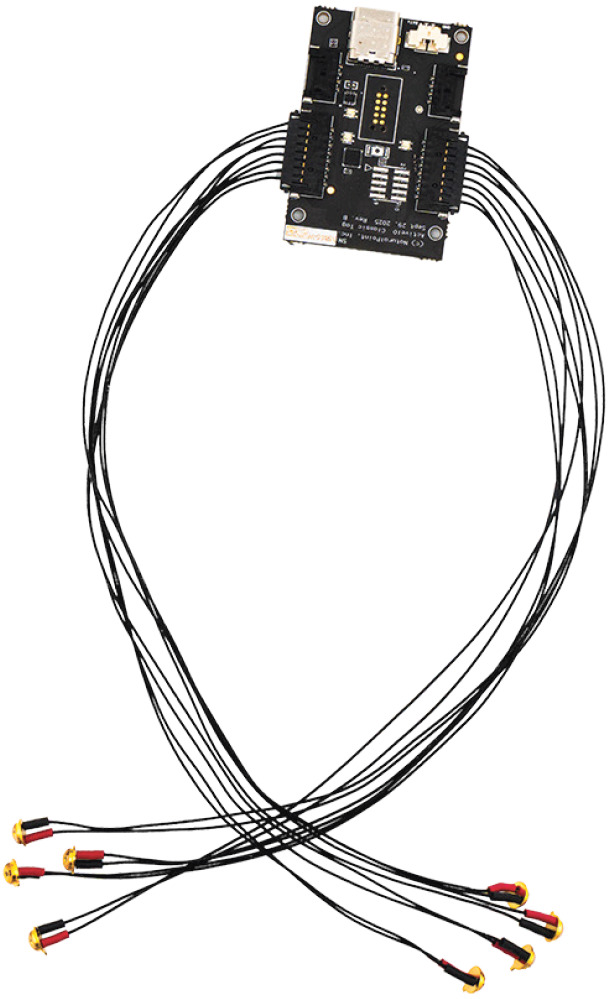
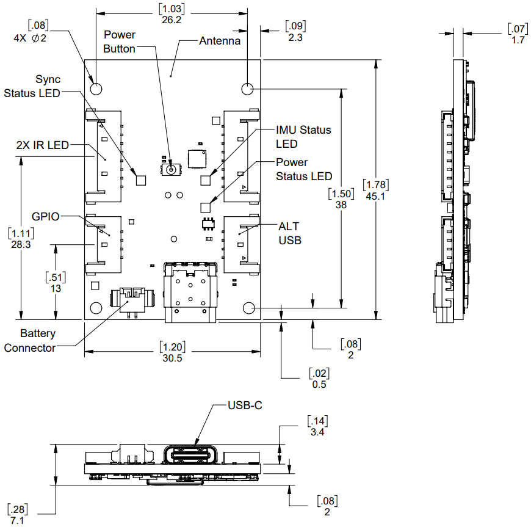

# ActiveIO Tag8

## Overview

The ActiveIO Tag8 is a tag with 8 attached LED markers that can be used to track an individual asset. The ActiveIO Tag8 is a printed-circuit assembly (PCA) that lets users integrate OptiTrack's ActiveIO technology into motion-capture assets of their own making. It's the same technology built into other ActiveIO devices, including HMD Clips.

<figure><figcaption></figcaption></figure>

## Quick Start Guide

### Requirements

* Motive 3.5 or later.
* ActiveIO BaseStation. See the [ActiveIO BaseStation page](activeio-basestation.md) for instructions on setting up and using an ActiveIO BaseStation.&#x20;

### Setup

The ActiveIO Tag8 needs no assembly before use.

### Activation

1. The ActiveIO Tag8 can be powered by a battery via connector or by an outside power source via USB-C port. When the Tag8 is connected to a battery, press the Power Button (see diagram below) to turn it on. The button is very small; you can activate is effectively by using a fingernail, pen, or pencil to push it. If the Tag8 is powered by an external source via USB, it automatically powers on.
2. Once powered, the Tag8 appears in Motive.

### Operation

The ActiveIO Tag8 needs no programming with a unique label. Once connected to Motive, all labeling is automatic.&#x20;

When a battery is connected, the Tag8 can charge the battery if it's connected to an outside power source via USB.

<figure><figcaption></figcaption></figure>

### Indicator LEDs and Power Button

#### Power Status LED (Lower Right)

* **Solid blue:** The device is on and connected to a battery; battery power is good.
* **Slow-blink red:** The battery is critically low (less than 10%).
* **Slow-blink green:** The battery is charging.
* **Solid green:** The battery is fully charged, or no battery is installed and the device is connected to an external power source.


When battery charge is low, IR marker LEDs become disabled until the connected battery is recharged to more than 10%.


#### Sync Status LED (Upper Left)

* **One-second blink blue:** The device is synced. (Intermittent orange blinks appear when timing packets aren’t received; a lot of orange blinks indicates poor RF conditions.)
* **One-second blink orange:** The device is synced (missed timing packet).
* **Slow-blink green:** The device is advertising (claimed).
* **Slow-blink violet:** The device is advertising (unclaimed).
* **Solid orange:** The device is on standby (wake-on-motion status).
* **Solid green:** The device is in Continuous mode.


To switch between either of the synced modes (Patterned and Always On) and the non-synced mode (Continuous), double-click the power button, wait 1 second, then double-click it again.


#### IMU Status LED (Upper Right)

* **Fast-blink orange:** The Inertial Measurement Unit (IMU) needs calibration. (To calibrate, set the device on a flat surface for a few seconds until the LED turns solid orange.)
* **Solid orange:** The IMU is calibrated.
* **Fast-blink violet:** Fusing
* **Solid blue:** Fused

#### All LEDs at Once

* **Solid yellow:** The device has been selected in the Devices pane of Motive (this lets users identify the device when more than one is active in the volume).
* **Cycle through all colors:** The device is updating firmware.

## Modes

The ActiveIO Clip has two synced modes (Patterned and Always On) and one non-synced mode (Continuous). To switch between Patterned and Always On modes, a property is available in Motive. To switch between either of the synced modes (Patterned and Always On) and the non-synced mode (Continuous), double-click the power button, wait 1 second, then double-click it again.

#### Patterned and Always On (Synced)

Patterned and Always On modes are synchronized with the camera system through an ActiveIO BaseStation. Synchronization allows the IR markers to be as bright and visible as possible when needed while reducing power consumption overall. The upper left indicator LED on the Tag8 blinks blue when it's synced.&#x20;


The two synced modes (Patterned and Always On), do not work with the previous generation Active BaseStation.


The two synced modes differ as follows:

* **Patterned:** Each IR marker LED flashes a unique identifying pattern.
*
  **Always On:** All IR marker LEDs are on during camera exposure.

#### Continuous (not Synced)

Continuous mode is not synchronized and does not require an ActiveIO BaseStation. In Continuous mode, the IR LEDs emit constant light with no blinking and are not synced with the camera exposure. The markers can appear dimmer to the cameras than they do in the synced modes, and power consumption is increased. In Continuous mode, the upper left indicator LED on the Tag8 is solid green.

## Specifications

<figure><figcaption></figcaption></figure>

Electrical Attributes

* **On/Off:** Button
* **Power Input:** USB 5V
* **Power Draw (@PSE):** 100 mA (Idle), 150 mA (Paired)
* **Connector:** USB Type-C / 4 Pin Molex Header

Dimensions

* **Width:** 30.5 mm / 1.2 inches
* **Height:** 45.1 mm / 1.78 inches
* **Distance Between Mounting Holes (Width):** 26.2 / 1.03 inches
* **Distance Between Mounting Holes (Height):** 38 mm / 1.5 inches
* **Depth of Board:** 1.7 mm / .07 inch
* **Depth of Board with Components:** 7.1 mm / .28 inch

LEDs

* **LED Markers:** 8
* **LED Indicators:** 3

RF

* **Frequency:** 2.4 GHz
*
  **FCC:** CISPR 32 CLASS A/2.4GHz Intentional Radiator
*
  **FCC ID:** XPYNORAB2 PART 15 of FCC Rules

